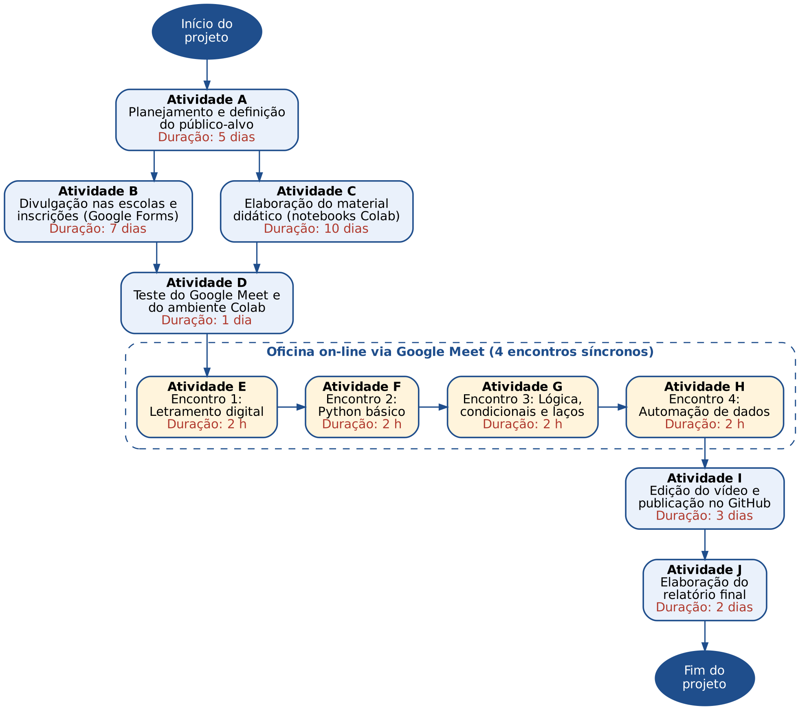

# Oficina de Letramento Digital e Programação Básica com Python

Projeto de **Atividade Extensionista II: Tecnologia Aplicada à Inclusão Digital** — CST em Ciência de Dados, Centro Universitário Internacional UNINTER.

**Autor:** Ítalo Albuquerque da Silva  
**Público-alvo:** estudantes do ensino médio de escolas públicas da rede estadual de Fortaleza – CE  
**Formato:** 4 encontros síncronos de 2 h pelo **Google Meet**, com prática no **Google Colab** (sem instalar nada, funciona no computador ou no celular)  
**ODS:** 4 – Educação de qualidade · 9 – Indústria, inovação e infraestrutura · 10 – Redução das desigualdades

---

## Objetivos

- Diagnosticar o conhecimento prévio dos participantes em informática, navegação na web e lógica, com um questionário de nivelamento.
- Desenvolver material didático prático em Python, usando notebooks do Google Colab.
- Capacitar os estudantes na resolução de problemas lógicos e na automação básica de dados, promovendo a inclusão digital e o interesse pelas áreas STEM.

## Conteúdo do repositório

```
.
├── notebooks/                        # material das aulas (abrir no Colab)
│   ├── 01_letramento_digital.ipynb
│   ├── 02_python_basico.ipynb
│   ├── 03_logica_condicionais_lacos.ipynb
│   └── 04_automacao_dados.ipynb
├── exercicios/
│   └── gabarito.py                   # soluções comentadas dos exercícios
├── avaliacao/
│   ├── questionario_diagnostico.md   # aplicado antes da oficina (Google Forms)
│   ├── questionario_final.md         # aplicado depois da oficina (Google Forms)
│   ├── analise_questionarios.py      # compara antes x depois e gera gráficos
│   └── exemplo_ficticio/             # dados FICTÍCIOS só para testar o script
├── metodologia/
│   ├── diagrama_metodologia.dot      # fonte do diagrama (Graphviz)
│   └── diagrama_metodologia.png
├── requirements.txt
└── LICENSE
```

## Encontros

| Encontro | Tema | Duração | Notebook |
|---|---|---|---|
| 1 | Letramento digital, segurança na internet e primeiros passos no Colab | 2 h | [01](notebooks/01_letramento_digital.ipynb) |
| 2 | Python básico: variáveis, tipos, `input()` e f-strings | 2 h | [02](notebooks/02_python_basico.ipynb) |
| 3 | Lógica: condicionais, listas, laços e jogo de adivinhação | 2 h | [03](notebooks/03_logica_condicionais_lacos.ipynb) |
| 4 | Automação de dados com pandas: boletim automático e gráficos | 2 h | [04](notebooks/04_automacao_dados.ipynb) |

## Metodologia



## Como a oficina usa este material

**Estudantes:** recebem no chat do Meet o link do notebook de cada encontro, abrem no Google Colab e salvam uma cópia no próprio Drive. Não precisam instalar nada.

**Avaliação:** antes do primeiro e depois do último encontro, os estudantes respondem aos questionários de `avaliacao/` pelo Google Forms. O script `avaliacao/analise_questionarios.py` compara as respostas de cada participante (autoavaliação e questões de conhecimento) e gera os indicadores e gráficos apresentados no relatório final. Os arquivos em `avaliacao/exemplo_ficticio/` contêm dados inventados, usados apenas para testar o script.

## Privacidade
Os participantes são identificados apenas por um código escolhido por eles; nenhum nome, telefone ou e-mail é publicado neste repositório.

## Licença
[MIT](LICENSE)
